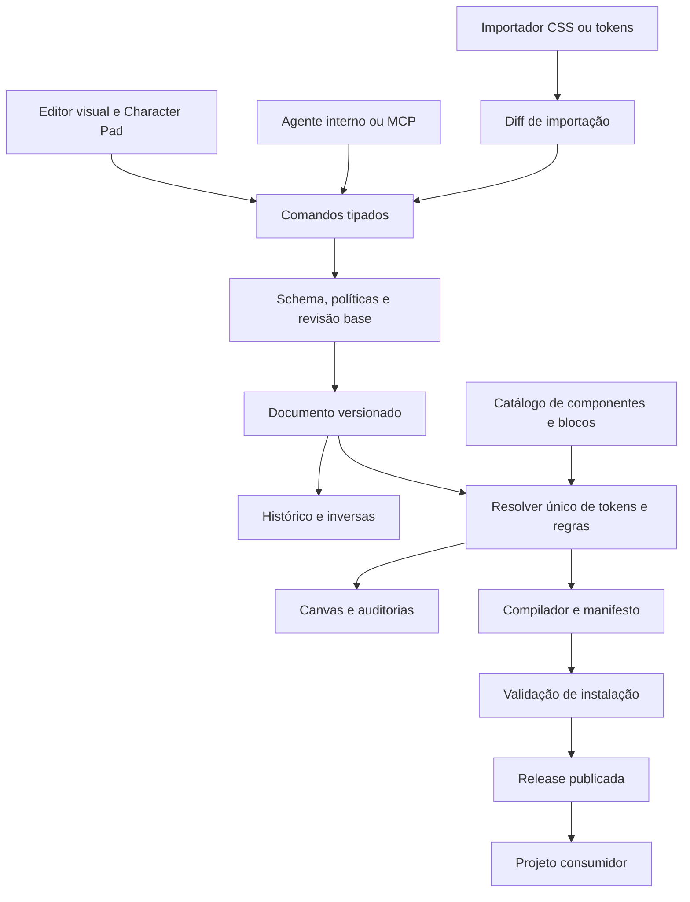

# shadcndesign × Koyot: análise crítica e oportunidades

Data da consulta: **15 de outubro de 2026**. Base: documentação pública, quatro artigos solicitados, um artigo complementar e inspeção do código deste checkout do Koyot.

Documentos relacionados: [inventário das fontes](./shadcndesign-fontes-2026-10-15.md) e [backlog de evolução](../roadmaps/design-system-evolution.md).

## 1. Parecer executivo

**Vale aproveitar a arquitetura de consistência entre edição visual, operações de agentes e distribuição de código.** Essa é a principal oportunidade para o Koyot. Expandir o número de componentes ou lançar um MCP antes de resolver essa consistência aumentaria a superfície de problemas.

Minha ordem recomendada é:

1. Corrigir a fidelidade entre preview, CSS, componentes e registry exportados.
2. Consolidar o modelo de tokens, regras e escopos de edição.
3. Adicionar histórico transacional, validação e políticas de marca.
4. Expor esse núcleo por MCP, inicialmente para leitura.
5. Ampliar composição, importação, colaboração e integrações de design.

O Koyot já possui fundamentos úteis: tokens reativos, quatro papéis tipográficos, métricas derivadas, componentes Base UI, inspeção de subelementos, SDK de blocos, registry local e geração de instruções de marca. O trabalho é transformar essas peças em um contrato confiável.

**Concordo com a direção da análise anterior, mas não com todo o diagnóstico nem com sua ordem de execução.** Ela subestima funcionalidades existentes e deixa de identificar problemas concretos na exportação.

## 2. Escopo e grau de certeza

- **Documentado pelo fornecedor:** comportamento descrito nas páginas oficiais. Não implica auditoria independente da implementação comercial.
- **Verificado no Koyot:** leitura dos arquivos deste checkout e verificações estáticas pontuais.
- **Proposta:** desenho de produto ou implementação sugerido neste relatório; não está pronto no aplicativo.
- **Hipótese:** precisa de teste com usuários, medição ou protótipo antes de virar compromisso.

O inventário cobre o índice de documentação, seus 40 destinos e os artigos indicados. Algumas páginas falharam na abertura direta e foram recuperadas por referências previamente abertas ou resultados oficiais indexados. A página de compartilhamento foi recuperada em versão indexada antiga; suas mudanças recentes foram confrontadas com o artigo de 11/10. Não foram inspecionados os arquivos pagos das skills, o kit Figma, o código proprietário ou uma sessão autenticada do DS Manager. Não foi feita uma varredura de todo o arquivo histórico do blog.

## 3. O que o benchmark realmente ensina

### 3.1 Um modelo compartilhado entre editor e código

O DS Manager documenta um canvas com componentes Base UI e publicação por registry. O sistema instalado deve corresponder ao que foi editado visualmente. Esse é um objetivo mais valioso para o Koyot do que copiar a aparência do editor. [Visão geral oficial](https://www.shadcndesign.com/docs/ds-manager)

**Aplicação proposta:** usar o mesmo catálogo de implementações, metadados e resolução de estilos no preview e no exportador. Um componente sem exportação funcional deve aparecer com cobertura incompleta, em vez de ser apresentado como pronto para instalar.

### 3.2 Tokens com referências, modos e origem explícita

O kit Figma distingue primitivas, estilo, modo claro/escuro e tipografia de texto longo. Seus aliases permitem que cores derivadas acompanhem a base. Isso não significa que todos os produtos preservem referências: o picker do DS Manager também oferece cópias de valores, e o plugin pode exportar tints achatados. [Variables](https://www.shadcndesign.com/docs/variables), [Colors and tokens](https://www.shadcndesign.com/docs/ds-manager-colors), [Manage variables](https://www.shadcndesign.com/docs/variables-management)

**Aplicação proposta:** o Koyot precisa distinguir valor literal, referência semântica e valor derivado. Mostrar de onde vem um valor e permitir “voltar a herdar”. Separar os eixos de identidade da marca, linguagem estrutural, densidade e tema claro/escuro. O Character Pad pode continuar como controle de alto nível, gerando alterações explícitas e reversíveis nesses eixos.

### 3.3 Edição com escopo de verdade

O editor deles organiza regras por parte, variante, tamanho e estado; o campo visual atua na regra responsável pelo valor. Também distingue uma demonstração interativa da matriz de variantes. [Editing components](https://www.shadcndesign.com/docs/ds-manager-components), [Variants and states](https://www.shadcndesign.com/docs/ds-manager-variants)

**Aplicação proposta:** um selo “Outline / Hover / Mobile” precisa corresponder ao endereço persistido da regra. No Koyot, `variantState` no alvo selecionado é informação de interface; o mapa atual de overrides não representa todos esses eixos. Antes de oferecer mais controles, garantir que editar uma variante não altere silenciosamente as demais.

### 3.4 Governança executável, com limites claros

As políticas deles combinam sete categorias de locks e regras gerais de código. Há níveis Off/Warn/Block; locks abrangem componentes padrão e suas partes, mas não ProBlocks nem componentes customizados. Edições humanas continuam permitidas. A exportação da política exige configurar o linter no projeto consumidor. [Lint locks](https://www.shadcndesign.com/docs/ds-manager-lint)

**Aplicação proposta:** criar Brand Policies com abrangência declarada para tokens, componentes e blocos do Koyot. A validação deve ocorrer no núcleo que aplica mudanças; instruções no prompt e um JSON exportado não bastam. O consumidor precisa de um validador efetivo e de execução no CI para tornar a política verificável fora do editor.

### 3.5 Alterações de agentes com autoria e reversão

O agente interno agrupa uma rodada em uma alteração reversível e verifica o canvas. O MCP documenta mudanças visíveis, um banner por execução e revisão para determinadas importações e sincronizações. Publicar continua sendo uma ação no aplicativo. Isso descreve uma experiência transacional; não prova atomicidade de banco de dados. [Design agent](https://www.shadcndesign.com/docs/ds-manager-agent), [anúncio do MCP](https://www.shadcndesign.com/blog/ds-manager-mcp-server)

**Aplicação proposta:** humano, Character Pad, presets, importador e agente devem usar a mesma API de comandos. Cada lote registra autor, base de revisão, mudanças, resultado de validação e inversa. Um drag deve gerar uma entrada de histórico, não dezenas. Undo precisa preservar edições posteriores ou declarar conflito.

### 3.6 MCP como acesso ao domínio

As 29 ferramentas documentadas incluem leitura, edição, inspeção, componentes e integrações. `view_page` fornece descrição textual e contraste; não equivale a screenshot. O sync Figma depende da conexão Figma do agente e tem limitações de kit, arquivo e permissões. [MCP server](https://www.shadcndesign.com/docs/ds-manager-mcp)

**Aplicação proposta:** começar com poucas ferramentas de leitura úteis e estáveis. Só liberar escrita depois de existirem políticas e histórico. Não há motivo para reproduzir a contagem de ferramentas. Separar ferramentas de edição do projeto das operações que distribuem uma release.

### 3.7 Controles como família

O painel Controls compartilha alturas por tamanho e configura foco; exceções podem se desconectar e voltar a herdar. Os valores 24/32/36/40 apresentados na documentação são um exemplo, e os defaults dependem do estilo. Não se deve interpretar a comparação de tamanhos diferentes de Button/Input como um defeito universal do shadcn/ui. [Controls](https://www.shadcndesign.com/docs/ds-manager-controls)

**Aplicação proposta:** aproveitar `--control-sm/md/lg` existentes, expor sua matriz e eliminar as fórmulas divergentes. Permitir exceções justificadas por componente. Tamanho visual e área de interação devem ser modelados separadamente quando necessário.

### 3.8 Componentes customizados como artefatos verificáveis

O DS Manager documenta validação de imports, estilos e capacidades antes de aceitar componentes gerados. Falhas persistentes viram drafts excluídos da publicação. Essas verificações são uma restrição de produto; a documentação pública não comprova isolamento completo de execução. [Custom components](https://www.shadcndesign.com/docs/ds-manager-custom-components)

**Aplicação proposta:** evoluir o SDK existente com contrato verificável, estados draft/validado e relatório de cobertura. Não aceitar geração arbitrária em runtime dentro do editor principal. Preview de código não confiável exigiria isolamento específico.

### 3.9 Composição, contexto e texto longo

Slots nativos do Figma permitem substituir conteúdo sem destacar instâncias. Separar a moldura de uma prancheta da identidade visual é outro problema, embora ambos favoreçam composição. [Agent Skills and Figma Slots](https://www.shadcndesign.com/blog/agent-skills-and-figma-slots-update)

O catálogo do DS Manager compartilha estilos de seção entre blocos e oferece prévias responsivas. O sistema Typeset trata prosa com largura de leitura, fluxo e escala próprios. [ProBlocks](https://www.shadcndesign.com/docs/ds-manager-problocks), [Typeset](https://www.shadcndesign.com/docs/typeset)

**Aplicação proposta:** manter pranchetas editoriais proporcionais e acrescentar um modo distinto para layouts responsivos reais. Criar slots tipados de conteúdo no SDK e receitas de páginas. Aproveitar o papel editorial para manifesto, guideline, documentação e respostas de IA com texto longo.

## 4. Diagnóstico do Koyot com evidências

Os caminhos abaixo são relativos à raiz do repositório. As linhas referem-se ao checkout consultado nesta data.

| Área | Evidência local | Diagnóstico |
| --- | --- | --- |
| Estado e persistência | `frontend/context/BrandSystemContext.tsx:36`, `:99`, `:156` | Tokens e páginas são salvos no navegador. Há chave v2, mas não encontrei schema versionado e migrações explícitas de documento. |
| Histórico global | `frontend/context/BrandSystemContext.tsx:235` | As mutações usam setters. Não encontrei pilha global undo/redo para o documento. Existem componentes de UI com Undo, sem equivaler ao histórico do Studio. |
| Registry local | `backend/server.js:500` | `/r/sync` e `/r/:item` já existem; armazenamento em `Map`, compartilhado por processo e sem releases persistidas. |
| Trabalho por edição | `frontend/context/BrandSystemContext.tsx:203`; `frontend/components/ShadcnExportModal.tsx` | Contexto e modal possuem fluxos que regeneram e enviam o catálogo inteiro. Há oportunidade de consolidar sincronização e invalidar somente o que mudou; o ganho precisa ser medido. |
| Exportação por CLI | `frontend/components/ShadcnExportModal.tsx:53` | Comandos de instalação, CSS, JSON e skill já estão no produto; funcionamento completo no consumidor ainda precisa de validação. |
| Exportação funcional | `frontend/utils/shadcnRegistryGenerator.ts:198`, `:404` | Há 57 entradas no catálogo e geradores dedicados apenas para `button` e `slider`; as outras 55 usam o ramo genérico de `HTMLDivElement`/`
`. Isso não exporta a semântica e o comportamento dos componentes correspondentes. |
| Preview versus exportação | `frontend/components/Blocks/ShadcnSingleComponentSpecimen.tsx:22` | Preview usa componentes de `systems/koyot` sobre Base UI; exportações dedicadas usam Radix. A diferença exige um adapter deliberado ou uma implementação única. |
| CSS e semântica | `frontend/utils/shadcnRegistryGenerator.ts:38`, `:74`, `:115` | O gerador emite diretivas de formato antigo e não emite `@theme`. Declara `--accent` duas vezes: primeiro como tupla HSL de `accentColor`, depois como HEX de `primaryColor`. A última declaração vence no mesmo escopo. |
| Dependências de setup | `frontend/utils/shadcnRegistryGenerator.ts:145`, `:539` | A skill gerada pede `LimePortalProvider` de `@/lib/lime/portal`; o item `all` monta arquivos de componentes e skill, sem esse provider nem o conjunto de estilos de escopo correspondente. |
| Alturas existentes | `frontend/systems/koyot/ui/button.tsx:35`, `ui/input.tsx:18`, `ui/select.tsx:20` | Os três já consomem tokens compartilhados de altura. Não é necessário inventar o mecanismo do zero. |
| Divergência de métricas | `frontend/utils/overrideUtils.ts:59`, `:80`; `shadcnRegistryGenerator.ts:117` | Preview deriva 30/38/44 de uma combinação de spacing e fonte; CSS exportado deriva 32/40/48 apenas de spacing. Para ambos os fatores iguais a 1, os resultados já diferem. |
| Contraste existente | `frontend/utils/styleUtils.ts:466`, `:475`, `:483` | Já há luminância e razão de contraste. A busca encontrou `getContrastRatio` somente na definição; não encontrei painel de auditoria conectado. A escolha automática de texto usa um limiar de luminância. |
| Escopo de overrides | `frontend/types.ts`, `frontend/components/BrandStudioPanel.tsx:456` | Overrides são persistidos por bloco/parte; variante, estado e breakpoint ainda não formam um endereço completo de regra. |
| Consolidação de overrides | `frontend/context/BrandSystemContext.tsx:177` | O exportador agrega subelementos de várias instâncias pelo ID da primitiva; partes repetidas são sobrescritas pela ordem de leitura. Edição de instância e edição do sistema precisam ser distintas. |
| SDK de blocos | `frontend/sdk/block/registry.ts`, `defineBlock.ts`, `types.ts` | Há descoberta automática e scaffolding. `defineBlock` faz uma verificação básica em desenvolvimento, não validação completa do artefato. |
| Contrato do SDK | `frontend/sdk/block/types.ts:20`; `frontend/components/Blocks/BlockRenderer.tsx:120` | O renderer envia `block`, `isInspectMode`, `selectedTarget` e `onSelectSubElement`; a interface pública declara outro conjunto. É necessário alinhar o contrato antes de ampliar plugins/blocos. |
| Agente atual | `frontend/services/geminiService.ts` | Existe serviço de geração de conceito JSON. A busca no código de aplicação não encontrou seu consumo; não comprova um agente ativo operando o documento. |
| Identidade das instruções | `frontend/systems/koyot/README.md`, `SKILL.md` | Os arquivos ainda se apresentam como Lime. Isso merece auditoria de nomenclatura, imports, proveniência e adequação das regras ao produto. |

### Exemplo concreto de contraste

Com fundo `#808080`, o limiar atual de `getReadableTextColor` escolhe branco. O cálculo independente resulta em aproximadamente **3,9494:1** para branco e **5,0375:1** para `#09090B`. Para texto comum, a primeira combinação fica abaixo de 4,5:1. A escolha deve comparar as alternativas pelo contraste efetivo e pelo contexto do texto. A aprovação deve usar a razão sem arredondamento; o arredondamento serve apenas à exibição. [WCAG 2.2 — Contrast Minimum](https://www.w3.org/WAI/WCAG22/Understanding/contrast-minimum.html)

Esse exemplo foi calculado a partir da fórmula de luminância; não foi um teste visual do aplicativo. A função atual `getContrastRatio` arredonda para duas casas, o que também precisa ser separado da decisão de aprovação.

## 5. Revisão da análise do outro agente

Documento revisado: `/Users/leandroalex/.gemini/antigravity/brain/eff7405b-2d36-48a7-90f9-28a10f9d1d1c/benchmarking-shadcndesign-koyot.md`, além do texto colado anexado.

| Afirmação ou proposta anterior | Parecer | Ajuste necessário |
| --- | --- | --- |
| Brand Locks são uma oportunidade | Concordo | Definir política executável, alcance e precedência; distinguir travar tokens de impedir restyling de componentes. |
| Undo de agente em lote | Concordo | Primeiro construir histórico do documento para todas as origens. Undo visual não prova transação atômica no banco. |
| Auditoria de acessibilidade | Concordo com o objetivo | Começar por relatório de contraste com cobertura explícita. Um score de contraste não certifica acessibilidade completa. |
| “Koyot só tem getReadableTextColor” | Incompleto | Já existem `getLuminance` e `getContrastRatio`; falta integrar e melhorar os cálculos decisórios. |
| “Controles herdam alturas padrão independentes” | Não representa este checkout | Button, Input e Select já compartilham `--control-*`; a lacuna é a consistência entre resolvers, editor e exportação. |
| “Histórico básico via React state” | Não comprovado como histórico | React state não implica undo/redo. Encontrei persistência de estado, sem histórico global. |
| “Koyot opera via sidecar Antigravity” | Não comprovado | Backend inspecionado é proxy Vertex e registry local; não encontrei implementação MCP ou evidência do sidecar descrito. |
| Exportar tokens, Tailwind e skills | Já existe parcialmente | Consolidar a exportação existente; ela não deve ser tratada como funcionalidade inteiramente nova. |
| Separação da moldura está alinhada com slots | Analogia limitada | Separação visual é útil, mas slots exigem contrato de conteúdo e composição. `data-slot` também pode ser apenas um marcador de parte. |
| Koyot é “superior no apelo visual” | Hipótese, não conclusão demonstrada | Há uma proposta mais ampla de branding; superioridade exige comparar tarefas, resultados e percepção de usuários. |
| “205+ blocos” | Histórico desatualizado | Eram 205 no anúncio de 04/10; em 11/10 passaram a 337. [Atualização](https://www.shadcndesign.com/blog/shadcn-app-ecommerce-blocks-controls-theme-import) |
| Todos os fluxos Figma exigem review antes de criar | Generalização | A documentação diferencia conversão para novo sistema e para sistema existente. Não transportar a regra de um fluxo para todos. |
| Locks protegem todo o sistema deles | Generalização | A documentação exclui ProBlocks e custom components dessa cobertura. |
| Autoajustar contraste preservando matiz | Útil como opção | Preservar matiz não preserva percepção ou identidade; oferecer alternativas, comparar o resultado e respeitar tokens protegidos. |

As três omissões mais importantes do relatório anterior são **fidelidade da exportação**, **releases separadas de edição** e **restrições de reutilização do material comercial**.

## 6. Arquitetura recomendada para o Koyot

O desenho abaixo é uma proposta própria, não uma descrição da implementação interna do shadcndesign.

O editor pode continuar responsivo e otimista, mas qualquer mudança passa pelo núcleo de comandos. A publicação produz um snapshot validado. O MCP é mais uma entrada para esse núcleo. Um projeto consumidor recebe uma release identificável, não o estado transitório de um slider em movimento.

As referências de marca devem permanecer vivas no modelo. Os adapters de exportação decidem se o destino suporta referências CSS, exige valores resolvidos ou precisa de um arquivo complementar. Toda perda de informação deve ser declarada.

## 7. O que aproveitar, adaptar e adiar

| Decisão | Itens |
| --- | --- |
| Aproveitar agora | Estado explícito de override, retorno à herança, fontes de valor, matriz de controles, relatório de contraste, contrato de exportação, histórico de alterações. |
| Adaptar ao diferencial Koyot | Policies para identidade e materiais editoriais; slots para mockups; receitas que combinam guideline, campanhas e produto; papéis tipográficos UI/brand/editorial/data. |
| Fazer após o núcleo | MCP com escrita, importação com diff, publicação persistente, compartilhamento de versões, forks e colaboração. |
| Adiar até haver demanda | Biblioteca com centenas de blocos, várias bibliotecas de primitivas simultâneas, marketplace e sincronização bidirecional ampla com Figma. |

O Koyot pode se diferenciar conectando **identidade → aplicações de marca → componentes de produto → código distribuído**. Isso é uma direção de produto plausível; ainda precisa de validação com quem cria e implementa marcas.

## 8. Reutilização e termos publicados

Os termos distinguem os componentes shadcn/ui subjacentes dos materiais comerciais do fornecedor. ProBlocks e skills pagos têm restrições de redistribuição, e há uma cláusula específica contra usar o DS Manager ou o que ele produz para construir uma ferramenta concorrente. Portanto, a proposta deste relatório é estudar padrões públicos e desenvolver implementação própria; não importar exports deles ou redistribuir seu catálogo dentro do Koyot. [Termos oficiais, seções Code resources e DS Manager](https://www.shadcndesign.com/licensing)

Nenhum recurso comercial foi baixado ou incorporado nesta análise. Caso se considere integração ou compra para uso dentro do produto, os direitos desse uso precisam ser esclarecidos antes de incorporar os materiais. As licenças e a origem dos componentes já presentes no Koyot também devem acompanhar seu manifesto de distribuição.

## 9. Validação realizada e limites

- Leitura das fontes oficiais e comparação de anúncios históricos com documentação e anúncios mais recentes.
- Leitura do modelo, contexto, utilitários, renderer, SDK, exportador, modal e endpoints de registry do Koyot.
- Contagem estática: 57 entradas no catálogo; 2 branches dedicados e 55 no fallback do gerador.
- Cálculo independente do exemplo de contraste e conferência das fórmulas de altura.
- A execução exploratória do gerador via bundling não prosseguiu porque `esbuild` não estava disponível no ambiente; não foram instaladas dependências para esta pesquisa.
- Não foi realizada instalação do registry em projeto limpo, teste do MCP comercial, auditoria completa de acessibilidade ou medição de performance. As alegações do fornecedor sobre velocidade não são medições nossas.
- Somente documentação foi adicionada ao repositório; a aplicação não foi alterada.

Próxima entrega recomendada: **um fluxo completo de componente real, editável e instalável**, com tokens consistentes, estados preservados, contraste reportado e undo em lote. Os critérios estão no [backlog](../roadmaps/design-system-evolution.md).
